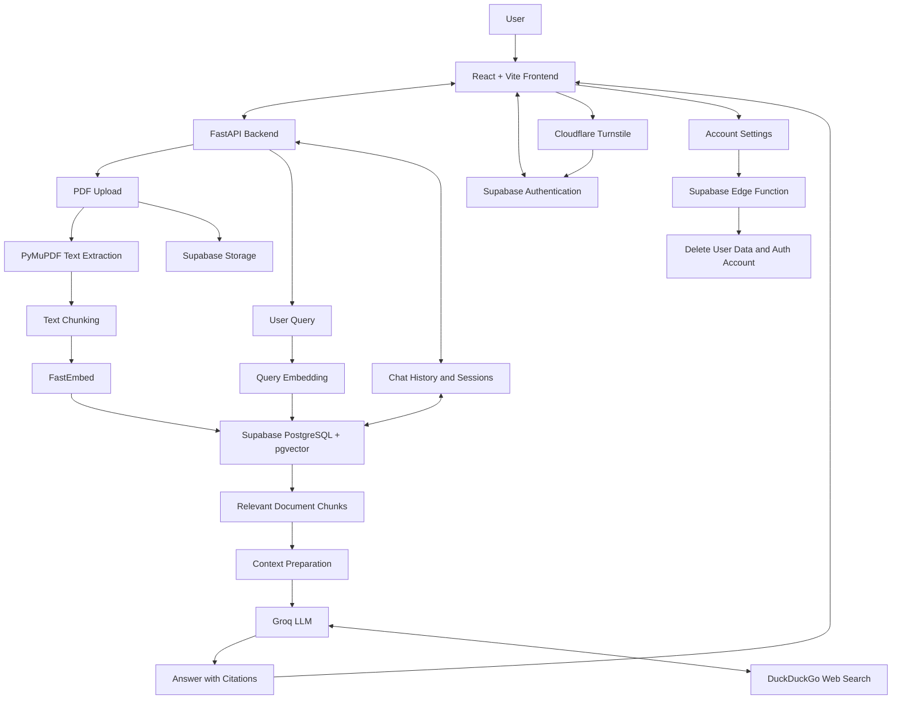

# IntelliDoc AI – AI-Powered PDF Chatbot

IntelliDoc AI is a full-stack AI document assistant that allows users to upload PDF files, ask questions in natural language, and receive context-aware answers using **Retrieval-Augmented Generation (RAG)**. It combines semantic search, Large Language Models (LLMs), and web search to simplify document understanding.

## Technology Stack

| Category | Technologies |
|---|---|
| Frontend | React.js, Vite, CSS |
| Backend | Python, FastAPI |
| PDF Processing | PyMuPDF |
| Embeddings | FastEmbed (BAAI/bge-small-en-v1.5) |
| Vector Database | Supabase PostgreSQL, pgvector |
| File Storage | Supabase Storage |
| Authentication | Supabase Auth |
| Bot Protection | Cloudflare Turnstile |
| LLM | Groq API (GPT-OSS) |
| Web Search | DuckDuckGo |
| Serverless Functions | Supabase Edge Functions |
| Deployment | Docker, Docker Compose, Vercel, Render |
| Version Control | Git, GitHub |

## System Architecture



### Architecture Components

- **React + Vite:** Provides the user interface for authentication, PDF uploads, conversations, document management, and AI responses.
- **FastAPI:** Handles API requests, PDF processing, retrieval, authentication validation, and communication between services.
- **PyMuPDF:** Extracts text and page information from uploaded PDFs.
- **FastEmbed:** Converts document text and user questions into numerical embeddings.
- **Supabase PostgreSQL + pgvector:** Stores document chunks and embeddings and performs semantic similarity searches.
- **Supabase Storage:** Stores uploaded PDF files in cloud storage.
- **Supabase Auth:** Manages user registration, email/password authentication, Google OAuth, and user sessions.
- **Cloudflare Turnstile:** Protects email/password login against automated requests.
- **Groq LLM:** Generates natural-language responses using retrieved document context.
- **DuckDuckGo:** Retrieves external web information when required.
- **Supabase Edge Functions:** Performs secure server-side account deletion and associated data cleanup.

## Working Process

1. **Document Processing:** Users upload PDF files. PyMuPDF extracts their text, which is divided into smaller chunks and converted into embeddings using FastEmbed. Original PDFs are stored in Supabase Storage, while document metadata, chunks, and embeddings are stored in PostgreSQL with pgvector.

2. **Question Processing:** The user's question is converted into an embedding. pgvector searches for semantically relevant document chunks.

3. **Context Preparation:** Retrieved document passages are provided to the language model as context.

4. **Answer Generation:** Groq generates a natural-language response grounded in the retrieved information, including relevant PDF filenames and page references.

5. **Web Search:** DuckDuckGo can retrieve external references when additional information is required.

6. **Response Delivery:** FastAPI returns the response to React, where it is displayed using Markdown formatting. Conversations and chat history are stored in Supabase.

## Features

### AI-Powered Document Chat
- PDF upload, text extraction, and document management.
- Semantic search using FastEmbed and pgvector.
- RAG-based question answering using Groq LLM.
- Context-aware responses grounded in uploaded documents.
- PDF filename and page-level source citations.
- DuckDuckGo web search for additional information.
- AI-generated suggested follow-up questions.
- Markdown-formatted conversational responses.

### Chat Management
- Multiple chat sessions.
- Persistent conversation history.
- Create, open, and delete conversations.
- Continue conversations using previous context.

### Authentication and Security
- Email/password registration and login using Supabase Auth.
- Google OAuth sign-in.
- Cloudflare Turnstile verification for email/password login.
- Separate CAPTCHA handling from signup and Google authentication.
- Authenticated user sessions and protected backend requests.
- Supabase Row Level Security (RLS) for user data isolation.

### Profile and Account Settings
- Dedicated profile and account settings section.
- View account information and registered email.
- Access account management from the application interface.
- Permanent account deletion with confirmation.
- Secure deletion through a Supabase Edge Function.
- Cleanup of user-owned PDF files, document records, chunks, chat messages, and chat sessions before deleting the authentication account.

**Account deletion security:** The frontend invokes the Edge Function using the authenticated user's session. Privileged credentials remain server-side and are never exposed in browser code. Each deletion request derives the user identity from the verified session rather than accepting an arbitrary user ID from the frontend.

## How It Works

IntelliDoc AI processes uploaded PDFs using PyMuPDF, extracts their text, and divides it into smaller chunks. FastEmbed converts these chunks into numerical embeddings, which are stored in Supabase PostgreSQL using pgvector.

When a user asks a question, the system generates an embedding for the query and performs semantic similarity search to retrieve relevant document chunks. These retrieved chunks are provided as context to the Groq LLM, which generates a natural-language answer based on the available information.

The chatbot returns formatted responses with relevant PDF filenames and page references. DuckDuckGo can provide additional external information when required.

The application also supports multiple conversations, persistent chat history, document management, suggested follow-up questions, user authentication, profile settings, and secure account deletion.

## Project Structure

```text
pdf_rag/
│
├── backend/
│   ├── app/
│   │   ├── services/
│   │   │   ├── __init__.py
│   │   │   ├── agent.py
│   │   │   ├── duckduckgo.py
│   │   │   └── rag.py
│   │   ├── __init__.py
│   │   └── main.py
│   ├── migrate_sqlite_to_supabase.py
│   └── Dockerfile
│
├── frontend/
│   ├── src/
│   │   ├── App.jsx
│   │   ├── index.css
│   │   └── main.jsx
│   ├── Dockerfile
│   ├── nginx.conf
│   ├── index.html
│   ├── markdown.css
│   ├── package-lock.json
│   ├── package.json
│   ├── postcss.config.js
│   ├── tailwind.config.js
│   └── vite.config.js
│
├── supabase/
│   └── functions/
│       └── delete-account/
│           └── index.ts
│
├── docker-compose.yml
├── requirements.txt
├── .dockerignore
├── .gitignore
├── .env.example
└── README.md
```

**Note:** Local-only folders and files such as `.venv/`, `node_modules/`, `data/`, SQLite databases, uploaded PDFs, and `.env` files are excluded from the GitHub repository.

## Installation and Setup

### Prerequisites

- Python 3.10+
- Node.js 22+
- npm
- Docker Desktop (optional, for Docker deployment)
- Git
- Supabase project
- Groq API key

### 1. Clone the Repository

```bash
git clone https://github.com/Vaishnavi304-MIT/PDF_RAG.git
cd PDF_RAG
```

### 2. Configure Environment Variables

Create `backend/.env`:

```env
SUPABASE_URL=your_supabase_project_url
SUPABASE_ANON_KEY=your_supabase_publishable_or_anon_key
GROQ_API_KEY=your_groq_api_key
GROQ_MODEL=your_configured_groq_model
TURNSTILE_SECRET_KEY=your_turnstile_secret_key
```

Create `frontend/.env`:

```env
VITE_SUPABASE_URL=your_supabase_project_url
VITE_SUPABASE_ANON_KEY=your_supabase_publishable_or_anon_key
VITE_API_BASE_URL=http://localhost:8000
VITE_TURNSTILE_SITE_KEY=your_turnstile_site_key
```

Use the actual variable names expected by your application configuration. Never expose Groq API keys, Turnstile secret keys, or Supabase privileged credentials through frontend environment variables.

### 3. Start the Backend

```powershell
cd backend
python -m venv .venv
.venv\Scripts\activate
pip install -r ../requirements.txt
```

Configure `backend/.env` before starting the server.

Run:

```bash
uvicorn app.main:app --reload
```

Backend: `http://127.0.0.1:8000`

API documentation: `http://127.0.0.1:8000/docs`

### 4. Start the Frontend

Open another terminal:

```bash
cd frontend
npm install
npm run dev
```

Frontend: `http://localhost:5173`

### 5. Configure Supabase Account Deletion

The account deletion workflow uses a Supabase Edge Function.

Install the Supabase CLI if required, authenticate, and link your project:

```bash
npx supabase login
npx supabase link --project-ref YOUR_PROJECT_REF
```

Configure the privileged secret securely through Supabase Edge Function secrets. Do not put it in the frontend or commit it to GitHub.

Deploy the function:

```bash
npx supabase functions deploy delete-account
```

The function verifies the signed-in user's identity and performs server-side deletion of their associated application data and Supabase Auth account.

Before production use, ensure the function's database table names, ownership columns, Storage bucket, and cleanup logic match your actual Supabase schema.

### 6. Run Using Docker

From the project root:

```bash
docker compose build
docker compose up -d
```

Frontend: `http://localhost:8080`

Backend: `http://localhost:8000`

Stop containers:

```bash
docker compose down
```

## Database Migration

IntelliDoc AI includes a migration workflow for transferring an existing local SQLite workspace to Supabase.

The migration script:

- Authenticates using a real Supabase Auth email/password session.
- Uses the public anon/publishable key and authenticated user's JWT.
- Migrates document metadata and document chunks.
- Generates embeddings for migrated chunks.
- Uploads available PDF files to Supabase Storage.
- Migrates chat sessions and chat messages.
- Applies Supabase Row Level Security through the authenticated user session.
- Preserves local SQLite data and uploaded files.

Migration configuration requires:

```env
SUPABASE_URL=your_supabase_project_url
SUPABASE_ANON_KEY=your_publishable_or_anon_key
```

Run the migration script using the Python environment configured for the backend.

## Security Considerations

- Keep Supabase privileged secret keys exclusively in trusted server-side environments.
- Never commit `.env` files or credentials to GitHub.
- Use Supabase Auth and RLS to isolate user-owned data.
- Validate authenticated sessions in backend endpoints.
- Verify user identity inside account deletion functions.
- Keep uploaded PDFs in private Supabase Storage.
- Test account deletion with a disposable account before production deployment.

## Results

### IntelliDoc AI – Application Interface


**Live Website:** [View IntelliDoc AI](YOUR_DEPLOYED_WEBSITE_URL)

## Future Enhancements

- OCR support for scanned PDFs.
- Support for additional document formats.
- Hybrid search and retrieval optimization.
- Improved retrieval accuracy and ranking.
- Further optimization of response speed and resource usage.

## Conclusion

IntelliDoc AI demonstrates the practical integration of Retrieval-Augmented Generation, semantic search, and generative AI into a full-stack document assistant. By combining PDF processing, contextual question answering, web search, cloud storage, multi-user authentication, and secure account management, the application provides an integrated workspace for interacting with documents through natural-language conversations.

---

**Developed using React, FastAPI, FastEmbed, Supabase, pgvector, Groq, DuckDuckGo, and Docker.**
