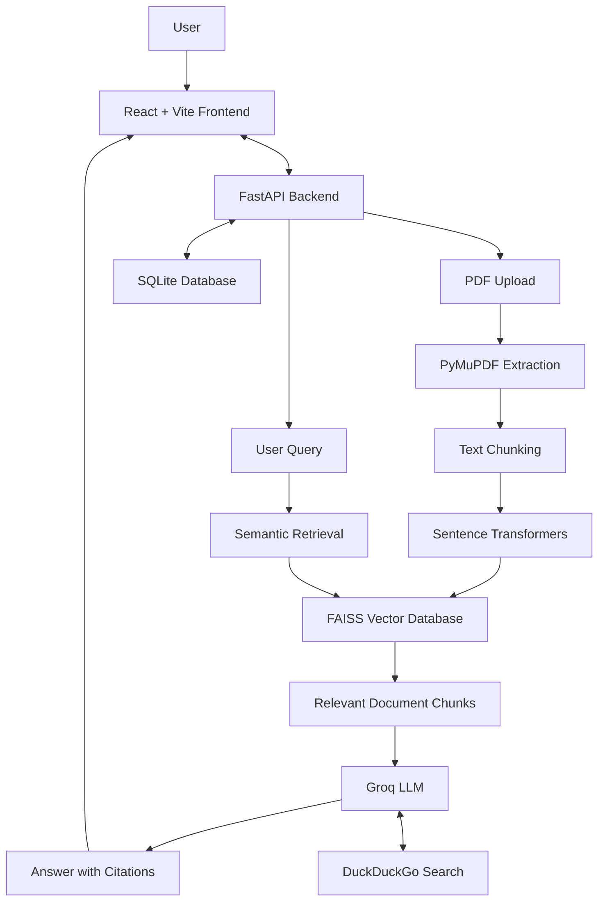

# IntelliDoc AI – AI-Powered PDF Chatbot

IntelliDoc AI is a full-stack AI document assistant that allows users to upload PDF files, ask questions in natural language, and receive context-aware answers using **Retrieval-Augmented Generation (RAG)**. It combines semantic search, Large Language Models, and web search to simplify document understanding.

## Features

- PDF upload, text extraction, and document management.
- Semantic search using Sentence Transformers and FAISS.
- RAG-based question answering using Groq LLM.
- PDF filename and page-level source citations.
- DuckDuckGo web search for additional information.
- Multiple chat sessions with history management.
- AI-generated suggested follow-up questions.
- Markdown-formatted conversational responses.

## Technology Stack

| Category | Technologies |
|---|---|
| Frontend | React.js, Vite, CSS |
| Backend | Python, FastAPI |
| PDF Processing | PyMuPDF |
| Embeddings | Sentence Transformers (`all-MiniLM-L6-v2`) |
| Vector Database | FAISS |
| Database | SQLite |
| LLM | Groq API |
| Web Search | DuckDuckGo |
| Deployment | Vercel, Render |
| Version Control | Git, GitHub |

## System Architecture



**Workflow:** PDF Upload → Text Extraction → Chunking → Embedding Generation → FAISS Retrieval → Groq LLM → Answer Generation.

## Project Structure

```text
pdf_rag/
│
├── backend/
│   ├── .venv/
│   ├── app/
│   │   ├── services/
│   │   │   ├── __init__.py
│   │   │   ├── agent.py
│   │   │   ├── duckduckgo.py
│   │   │   └── rag.py
│   │   ├── __init__.py
│   │   └── main.py
│   ├── data/
│   ├── .env
│   └── requirements.txt
│
├── frontend/
│   ├── node_modules/
│   ├── src/
│   │   ├── App.jsx
│   │   ├── index.css
│   │   └── main.jsx
│   ├── .env
│   ├── index.html
│   ├── markdown.css
│   ├── package-lock.json
│   ├── package.json
│   ├── postcss.config.js
│   ├── tailwind.config.js
│   └── vite.config.js
│
├── .gitignore
└── README.md
```

## Installation and Setup

**Prerequisites:** Python 3.10+, Node.js, npm, and Git.

### 1. Clone the repository

```bash
git clone https://github.com/YOUR_USERNAME/IntelliDoc-AI.git
cd IntelliDoc-AI
```

### 2. Start the backend

```bash
cd backend
python -m venv .venv
.venv\Scripts\activate
pip install -r requirements.txt
```

Configure the required environment variables in `backend/.env`, then run:

```bash
uvicorn app.main:app --reload
```

Backend: `http://127.0.0.1:8000`

API documentation: `http://127.0.0.1:8000/docs`

### 3. Start the frontend

Open another terminal:

```bash
cd frontend
npm install
npm run dev
```

Frontend: `http://localhost:5173`

Configure the frontend API URL in `frontend/.env` according to your backend configuration.

## Results

### IntelliDoc AI – Application Interface


**Live Website:** [View IntelliDoc AI](YOUR_DEPLOYED_WEBSITE_URL)

## Future Enhancements

- OCR support for scanned PDFs.
- Support for additional document formats.
- User authentication and access control.
- Hybrid search and retrieval optimization.
- Cloud-based persistent document storage.

## Conclusion

IntelliDoc AI demonstrates the practical integration of RAG, semantic search, and generative AI into a full-stack document assistant, enabling users to interact with PDF documents through natural-language conversations.

---

**Developed using React, FastAPI, FAISS, Sentence Transformers, and Groq.**
