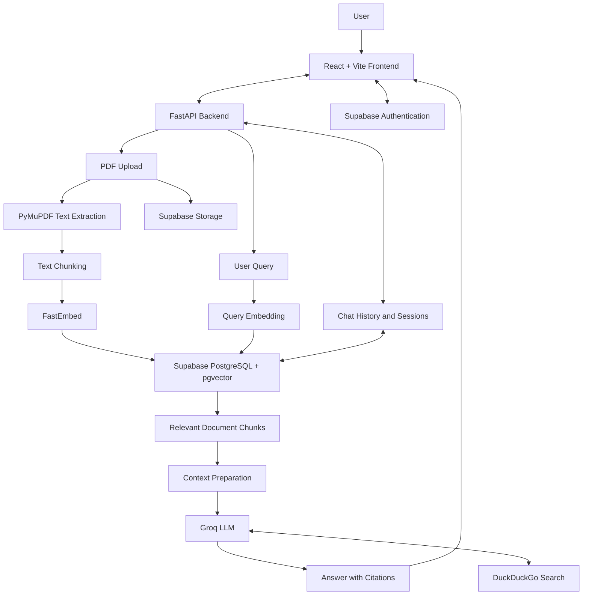

# IntelliDoc AI – AI-Powered PDF Chatbot

IntelliDoc AI is a full-stack AI document assistant that allows users to upload PDF files, ask questions in natural language, and receive context-aware answers using **Retrieval-Augmented Generation (RAG)**. It combines semantic search, Large Language Models, and web search to simplify document understanding.

## Technology Stack

| Category | Technologies |
|---|---|
| Frontend | React.js, Vite, CSS |
| Backend | Python, FastAPI |
| PDF Processing | PyMuPDF |
| Embeddings | FastEmbed (BAAI/bge-small-en-v1.5) |
| Vector Database | Supabase PostgreSQL, pgvector |
| File Storage | Supabase Storage |
| Authentication | Supabase Auth |
| LLM | Groq API (GPT-OSS) |
| Web Search | DuckDuckGo |
| Deployment | Docker, Docker Compose, Vercel, Render |
| Version Control | Git, GitHub |

## System Architecture



## Features

- PDF upload, text extraction, and document management.
- Semantic search using FastEmbed and pgvector.
- RAG-based question answering using Groq LLM.
- PDF filename and page-level source citations.
- DuckDuckGo web search for additional information.
- Multiple chat sessions with history management.
- AI-generated suggested follow-up questions.
- Markdown-formatted conversational responses.
- User authentication and cloud-based document storage.

## How It Works

IntelliDoc AI processes uploaded PDFs using PyMuPDF, extracts their text, and divides it into smaller overlapping chunks. FastEmbed converts these chunks into numerical embeddings, which are stored in Supabase PostgreSQL using pgvector.

When a user asks a question, the system generates an embedding for the query and performs semantic similarity search to retrieve relevant document chunks. These retrieved chunks are provided as context to the Groq LLM, which generates a natural-language answer based on the available information. The chatbot returns formatted text responses with relevant PDF filenames and page references. DuckDuckGo search can provide additional external information when required.

The application also supports multiple conversations, chat history, document management, and suggested follow-up questions.

## Project Structure

```text
pdf_rag/
│
├── backend/
│   ├── .venv/
│   ├── app/
│   │   ├── services/
│   │   │   ├── __init__.py
│   │   │   ├── agent.py
│   │   │   ├── duckduckgo.py
│   │   │   └── rag.py
│   │   ├── __init__.py
│   │   └── main.py
│   ├── data/
│   ├── .env
│   └── Dockerfile
│
├── frontend/
│   ├── node_modules/
│   ├── src/
│   │   ├── App.jsx
│   │   ├── index.css
│   │   └── main.jsx
│   ├── .env
│   ├── Dockerfile
│   ├── nginx.conf
│   ├── index.html
│   ├── markdown.css
│   ├── package-lock.json
│   ├── package.json
│   ├── postcss.config.js
│   ├── tailwind.config.js
│   └── vite.config.js
│
├── docker-compose.yml
├── requirements.txt
├── .dockerignore
├── .gitignore
└── README.md
```

## Installation and Setup

**Prerequisites:** Python 3.10+, Node.js 22+, npm, Docker, and Git.

### 1. Clone the repository

```bash
git clone https://github.com/Vaishnavi304-MIT/PDF_RAG.git
cd IntelliDoc-AI
```

### 2. Start the backend

```bash
cd backend
python -m venv .venv
.venv\Scripts\activate
pip install -r ../requirements.txt
```

Configure the required environment variables in `backend/.env`, then run:

```bash
uvicorn app.main:app --reload
```

Backend: `http://127.0.0.1:8000`

API documentation: `http://127.0.0.1:8000/docs`

### 3. Start the frontend

Open another terminal:

```bash
cd frontend
npm install
npm run dev
```

Frontend: `http://localhost:5173`

Configure the frontend environment variables in `frontend/.env`.

### 4. Run using Docker

From the project root:

```bash
docker compose build
docker compose up -d
```

Frontend: `http://localhost:8080`

Backend: `http://localhost:8000`

Stop containers:

```bash
docker compose down
```

## Results

### IntelliDoc AI – Application Interface


**Live Website:** [View IntelliDoc AI](YOUR_DEPLOYED_WEBSITE_URL)

## Future Enhancements

- OCR support for scanned PDFs.
- Support for additional document formats.
- Hybrid search and retrieval optimization.
- Improved retrieval accuracy and ranking.

## Conclusion

IntelliDoc AI demonstrates the practical integration of RAG, semantic search, and generative AI into a full-stack document assistant, enabling users to interact with PDF documents through natural-language conversations.

---

**Developed using React, FastAPI, FastEmbed, Supabase, pgvector, Groq, and Docker.**